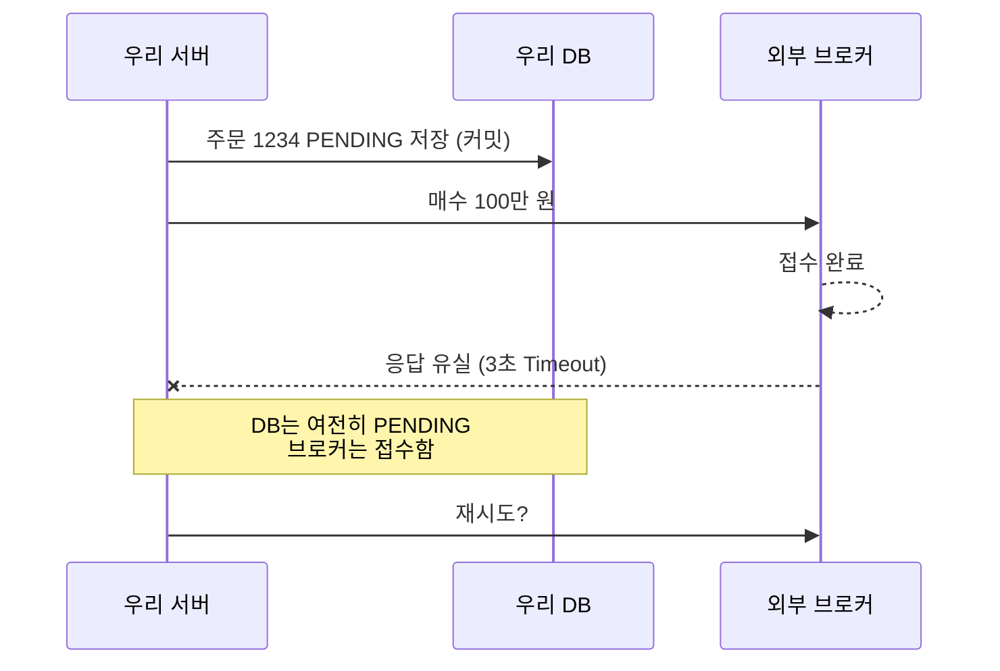

## 핵심 한 줄

**Timeout은 실패가 아니라 "모른다"이다.** 네트워크 경계를 넘는 순간, 상대가 처리했는지를 우리 트랜잭션으로는 알 수도 되돌릴 수도 없다.

## 장면

## 내 첫 답

> [!quote] 6번 — `@Transactional`이면 브로커 주문도 롤백되나?
> Tx의 Transactional은 현재 Datasource에서 가져온 DB의 트랜잭션을 관리해. 외부 http 요청은 DB 반영이 아닌 그냥 처리하라고 명령만 한 거여서, 그 요청에 트랜잭션이 있다면 이미 별도의 트랜잭션 처리가 끝난 상태야.

> [!quote] 9번 — Timeout 후 무엇을 하나 (멱등키 지원 여부 모름)
> 타임아웃 이후 접수가 됐는지 확인하는 api를 호출해야 돼. 없다면 브로커에 제공과 멱등키를 요청하고, 멱등키가 돼도 확인하는 api가 더 저렴할 것 같아. 확인 비용이 커지면 메시지 큐로 신뢰성을 확보할 수 있을까?

## 틀린 지점

> [!failure] 헤더에 주문 ID를 넣으면 멱등하다 (7번)
> ID를 보내는 것만으로는 아무 일도 안 생긴다. **받는 쪽(브로커)이 그 키로 중복을 막아 줘야** 효과가 있다.

> [!failure] 조회 API가 멱등키보다 싸다 (9번)
> 비교 기준이 틀렸다. 문제는 비용이 아니라 **정확성**이다. 조회 후 재전송 방식에는 조회 API가 완벽해도 남는 구멍이 있다. → 아래 열린 질문

> [!failure] 메시지 큐로 신뢰성 확보 (9번)
> 큐가 지켜 주는 건 "메시지가 사라지지 않고 다시 전달된다"(at-least-once)까지다. 브로커가 이미 처리했는지는 큐도 모른다. 오히려 재전달 때문에 중복이 생길 수 있다.

## 교정된 이해

- `@Transactional`은 우리 DB까지만 묶는다. 외부 HTTP 호출 동안 트랜잭션을 열어 두면 커넥션과 락만 오래 잡는다.
- 응답을 못 받은 주문은 FAILED가 아니라 **UNKNOWN**으로 둔다. 무조건 실패 처리하면 잘못된 상태를 기록하게 된다.
- 상태: `PENDING → SENDING → SUBMITTED / FAILED / UNKNOWN`. 브로커 접수와 실제 체결은 또 다른 사건이다.
- 비동기 ≠ 논블로킹 ≠ 메시지 큐
  - `@Async`: 호출한 스레드만 풀려나고, 다른 스레드가 응답을 기다린다.
  - 논블로킹 I/O (WebClient): 기다리는 동안 스레드를 놓아준다.
  - 메시지 큐: 만드는 쪽과 처리하는 쪽을 분리한다. 처리 속도를 올려 주지는 않는다.
- 사용자에게 결과를 알리는 길은 따로 고른다: Polling, SSE/WebSocket, Webhook(브로커 지원 필요).

## 열린 질문

> [!question]- 조회 API가 100% 정확해도 "Timeout → 조회 → 없음 → 재전송"에서 중복 주문이 나는 시나리오는?
> (아직 안 풀었음. 답을 쓰면 여기에 기록)

> [!question]- 10번: 재시도할 때마다 새 UUID를 멱등키로 만들면 무슨 일이 생기나?
> (아직 안 풀었음)

## 연결

- [[처리량과 큐 적체]]: 큐에 쌓인 주문을 꺼내 보낸 다음의 이야기
- [[c2]]: 멱등 원장 반영 구현 문항
- [[s4]]: Kafka와 멱등성 서술 문항
- [[d1]]: 대용량 트래픽 + 외부 연동 설계 문항
- [[net.timeout-retry]]: CS 스터디 타임아웃·재시도 토픽
